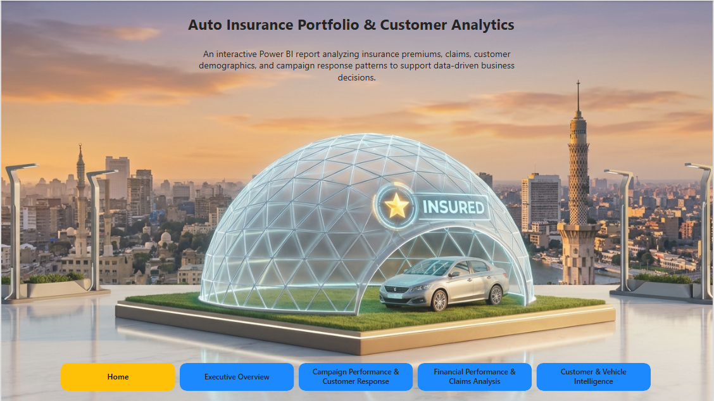

# 🚗 Auto Insurance Portfolio & Customer Analytics

An interactive, end-to-end Power BI business intelligence solution designed to analyze auto insurance premiums, claims loss exposure, customer demographics, and marketing campaign response patterns to drive data-informed underwriting and retention decisions.

---

## 📊 Project Overview
This project transforms raw insurance portfolio data into actionable operational and financial insights across a 4-page executive dashboard. The solution tracks **$851K in total premiums** across **27K active policies** and **9K unique customers**, while identifying critical risk exposures like **$3.96M in total claims** and a **4.66% Claim-to-Premium ratio**.

---

## 🏗️ End-to-End Data Pipeline Architecture

```text
┌────────────────────────┐      ┌────────────────────────┐      ┌────────────────────────┐
│   Raw Data Sources     │ ───► │  SQL Database (Engine) │ ───► │  Power BI Dashboards   │
│ (Excel / Power Query)  │      │ (Central Data Store)   │      │ (Visual Analytics)     │
└────────────────────────┘      └────────────────────────┘      └────────────────────────┘

## 🚀 Key Features & High-Level KPIs

- **Portfolio Volume:** Manages **$851K in Total Premiums** spanning **27,093 Active Policies** held by **9K Unique Customers**.
- **Financial Risk:** Evaluates **$3.96M in Total Claims** with an **Average Monthly Premium of $93.22** and a **Claim-to-Premium Ratio of 4.66%**.
- **Campaign Response:** Tracks marketing conversions with a **14.32% Overall Response Rate** (**1K Responders vs. 8K Non-Responders**).
- **Core Vehicle Fleet:** **Four-Door Cars** dominate policy volume (**13.8K policies / $357.8K premiums**), followed by Two-Door Cars (5.6K) and SUVs (5.2K).

---

## 📈 Dashboard & Technical Architecture Preview

### 1. Home Page Navigation


### 2. Executive Overview


### 3. Campaign Performance & Customer Response


### 4. Financial Performance & Claims Analysis


### 5. Customer & Vehicle Intelligence


---

## 🛠️ Multi-Page Architecture & Technical Execution

- **Home Page:** Interactive landing hub featuring direct page-action buttons designed for seamless report navigation.
- **Executive Overview Page:** Executive summary tracking core KPIs (Total Premiums, Total Claims, Customers, Active Policies, Average Monthly Premium) alongside monthly policy expiration trends and sales channel distributions.
- **Campaign Performance & Customer Response Page:** Deep-dive marketing analysis evaluating campaign response rates across education levels, marital status, gender, and offer types (notably highlighting Offer 2).
- **Financial Performance & Claims Analysis Page:** Comprehensive financial risk assessment measuring claim-to-premium ratios, claims breakdown by unemployment status, and premium distributions across income brackets.
- **Customer & Vehicle Intelligence Page:** Granular customer segmentation and vehicle fleet breakdown evaluating vehicle class, size hierarchies, and policy type distributions.

---

## 🛠️ Tools & Technologies
- **Data Transformation (ETL):** Excel Power Query for data cleansing, null handling, and table structuring.
- **Database Management:** SQL Server / Relational Database for central data staging and modeling.
- **Business Intelligence & Visualization:** Microsoft Power BI utilizing custom DAX calculations, page-action navigation, and dynamic KPI cards.

---

## 💡 Key Business Insights

- **Q1 Renewal Exposure:** Policy expirations surge heavily in **January (10.0K)** and **February (8.2K)**, signaling that customer retention initiatives must be front-loaded early in the year.
- **Winning Campaign Channels:** **Offer 2** yielded the highest response propensity at **23.38%** (vs. Offer 1 at 15.83%), with agent-led deliveries driving the strongest engagement (**19.88%**).
- **Underwriting Risk Exposure:** Employed policyholders account for the highest claim volume (**$2.04M**), followed by Unemployed customers (**$1.39M**), indicating a need to restructure risk-based premium pricing across employment brackets.
W
